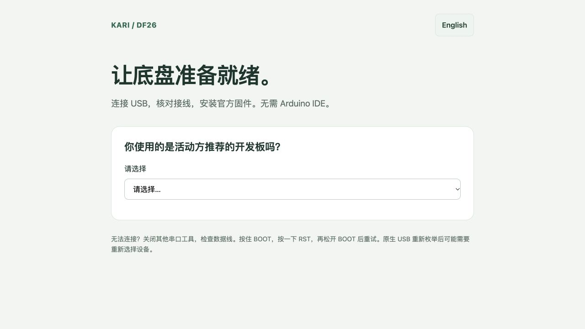

# 首次安装与接线

**语言 / Language:** [简体中文](#简体中文) · [English](#english)

## 简体中文

[返回项目首页](../README.md)

## 准备硬件

确认 ESP32-S3 模组的 Flash / PSRAM 规格：N16R8 对应 16 MB Flash、8 MB PSRAM；N8R8 对应 8 MB Flash、8 MB PSRAM。不要仅凭串口 Flash 检测推断 PSRAM 或引脚布局。

推荐板使用以下 GPIO 编号；不是排针序号。

| L298N 接口 | ESP32-S3 GPIO |
| --- | --- |
| 左 IN1 / IN2 / ENA | 16 / 15 / 17 |
| 右 IN3 / IN4 / ENB | 7 / 6 / 5 |

ESP32 与 L298N 共地，拔掉 ENA / ENB 跳帽。烧录与接线配置期间断开电机电源；驱动输入浮空时需合适下拉或保持电机断电。

## 安装固件

推荐按[Agent 部署工具说明](https://github.com/xlle-er/KARI-DF26-Skill#一句话安装并烧录)执行。工具会识别串口、下载并校验匹配的官方固件，再引导接线配置。多个设备时必须明确选择目标串口。

也可直接打开[网页安装页](https://xlle-er.github.io/KARI-DF26-Firmware/)，使用电脑 Chrome / Edge，按页面选择板型并安装。

需要本机运行时，可克隆[固件仓库](https://github.com/xlle-er/KARI-DF26-Firmware)，在 `installer` 目录执行 `npm ci`、`npm run dev`，使用电脑 Chrome / Edge 打开显示的 localhost 地址。清单需要配套的已构建固件文件，准备方法见[固件开发说明](https://github.com/xlle-er/KARI-DF26-Firmware#固件开发维护者)。

尚未提供有效固件 Release 时，先按模块说明构建，不能使用其他板型或历史固件替代。

## 配网、接线与客户端

1. 安装 KARI 固件后连接设备广播的 `KARI-…` Wi-Fi 热点，访问 `http://192.168.4.1/`。实际后缀以设备广播为准。
2. 按固件说明提供设备管理凭据，选择 2.4 GHz 网络并保存。初始凭据和修改方式见[固件说明](https://github.com/xlle-er/KARI-DF26-Firmware#配网与管理)。
3. 核对板型、六个电机 GPIO 和接线确认状态；未确认时保持电机禁用。
4. 接通电机电源，架空车轮执行短时方向校准，再停止。不要直接启用自动运动或视觉跟随。
5. 选择 [Web](web.md)、[Android](android.md) 或 [iOS](ios.md)，主动扫描并选择正确的机器人。

USB 烧录不会自动擦除整片 Flash；KARI 使用新的配置命名空间，历史配置不被读取，需要重新设置。

## English

### First installation and wiring

[Project home](../README.md)

### Prepare the hardware

Confirm the ESP32-S3 module: N16R8 means 16 MB Flash and 8 MB PSRAM; N8R8 means 8 MB Flash and 8 MB PSRAM. Flash detection alone cannot establish PSRAM or header layout.

The recommended board uses these **GPIO numbers**, not header positions:

| L298N interface | ESP32-S3 GPIO |
| --- | --- |
| Left IN1 / IN2 / ENA | 16 / 15 / 17 |
| Right IN3 / IN4 / ENB | 7 / 6 / 5 |

Share ground between ESP32 and L298N, and remove ENA / ENB jumpers. Disconnect motor power during flashing and wiring configuration. Floating driver inputs require appropriate pull-downs or disconnected motor power.

### Install firmware

Follow the [Agent deployment guide](https://github.com/xlle-er/KARI-DF26-Skill#一句话安装并烧录). The tool identifies the serial port, downloads and verifies matching official firmware, and guides wiring configuration. Explicitly select the correct port when multiple devices are present.

Alternatively, open the [web installer](https://xlle-er.github.io/KARI-DF26-Firmware/) in desktop Chrome / Edge and select the board.

For local hosting, clone the [firmware repository](https://github.com/xlle-er/KARI-DF26-Firmware), enter `installer`, run `npm ci` and `npm run dev`, and open the displayed localhost URL. The installer needs matching built firmware assets; see the [firmware development guide](https://github.com/xlle-er/KARI-DF26-Firmware#固件开发维护者).

If no suitable release exists, build the module as documented. Do not substitute a different board's package or historical firmware.

### Configure Wi-Fi, wiring and a client

1. After installation, connect to the actual `KARI-…` hotspot advertised by the device and open `http://192.168.4.1/`.
2. Supply the administration credentials documented in the [firmware guide](https://github.com/xlle-er/KARI-DF26-Firmware#配网与管理), choose a 2.4 GHz network and save it.
3. Confirm the board, all six motor GPIOs and wiring readiness. Motors remain disabled until configuration is confirmed.
4. Lift the wheels before connecting motor power. Run only short direction-calibration tests, then stop. Do not immediately enable autonomous movement or visual following.
5. Choose [Web](web.md), [Android](android.md) or [iOS](ios.md), scan and explicitly select your robot.

USB installation does not automatically erase the entire Flash. KARI uses new configuration namespaces, so historical settings must be configured again.
